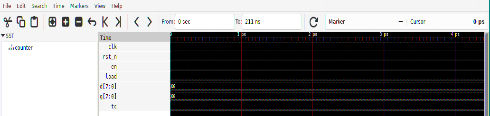

# Waveforms

This page answers: *the test says `q is 0x32, expected 0x31`. I have read the RTL four times and
it looks right. Now what?*

Now you look at the wires.

An assertion tells you that something was wrong at one instant. A waveform shows what everything
was doing for the whole run. You reach for one when the assertion has stopped narrowing things
down, usually because the wrong value came from somewhere you were not watching, or arrived at
the wrong time rather than with the wrong value.

Most bugs in this course are cheaper to find with a better assertion message than with a viewer,
and opening the waveform first is a habit that costs hours. But some bugs are only visible as a
picture, and this page is for those. You'll do everything on it in
[cocotb on a counter, Part 5](labs/cocotb-intro-overview.md#part-5-waveforms).

## Getting a waveform out

`make waves` in `labs/cocotb-intro` runs `test_04_waves.py` with dumping turned on:

```
    11.00ns INFO  cocotb.counter  reset released at t = 11 ns
   111.00ns INFO  cocotb.counter  counted to 0x0A at t = 111 ns
   121.00ns INFO  cocotb.counter  loaded 0xFF at t = 121 ns  <-- zoom here
   151.00ns INFO  cocotb.counter  held 3 clocks with en low, still 0xFF, t = 151 ns
   152.00ns INFO  cocotb.counter  en high again at t = 152 ns; the wrap is the next edge
   161.00ns INFO  cocotb.counter  wrapped to 0x00 at t = 161 ns
   211.00ns INFO  cocotb.counter  finished at t = 211 ns with q = 0x05
...
FST info: dumpfile /work/labs/cocotb-intro/build/waves/counter.fst opened for output.

   wrote  /work/labs/cocotb-intro/counter.fst   (699 bytes)
   wrote  /work/labs/cocotb-intro/counter.vcd   (1098 bytes)
```

The `FST info: dumpfile ... opened for output.` line appears after the results table. That is
Icarus closing the file at the end of the run. It is not an error, and the test had already
passed.

The mechanism is one make variable, `WAVES=1`, passed to cocotb's makefile. It makes cocotb's
Icarus makefile generate a dump module for you, so you never write `$dumpfile` or `$dumpvars`:

```
/foss/tools/bin/iverilog ... -s cocotb_iverilog_dump  rtl/counter.sv build/waves/cocotb_iverilog_dump.v
```

The dump lands at `$(SIM_BUILD)/$(COCOTB_TOPLEVEL).fst`, here `build/waves/counter.fst`. The
package's `make waves` copies it up to `counter.fst` and converts it with `fst2vcd`, so you have
both formats.

> When you drive `sim.mk` by hand and change `RTL=`, change `SIM_BUILD=` with it. cocotb's
> makefile relinks only when the sources are newer than `sim_build/sim.vvp`, so a second run
> against a different design silently reruns the first one: green, and testing something other
> than what you meant. Every package target passes its own `SIM_BUILD` for that reason.

> Searching for "cocotb waveform" will turn up `COCOTB_PLUSARGS=+WAVES` and hand-written
> `$dumpvars` testbench shells. Both are real techniques. SimProc's `tb.v` uses that approach,
> because it has a Verilog shell to put it in. For a design cocotb attaches to directly,
> `WAVES=1` does the job in one word. Write the shell yourself only when you need to dump a
> subset of a large design.

## FST or VCD

They hold the same information in two encodings. Use FST unless something refuses it.

| | This counter | SimProc, `labs/common` → `make waves` |
|---|---|---|
| Signals in the file | 7 | 190 (across 11 scopes) |
| VCD | 1,098 bytes | 3,007,592 bytes |
| FST | 699 bytes | 12,152 bytes |

The SimProc run is 247 times smaller as FST. VCD is text and writes every value change out in
ASCII; FST is compressed and indexed, so viewers can seek in it without reading the whole file.
`fst2vcd` and `vcd2fst`, both on the workbench `PATH`, convert either way.

VCD is still worth knowing: everything reads it, and you can open it with `less` when you suspect
the viewer rather than the data.

## Opening a viewer

Start Surfer and GTKWave by typing their names in a terminal on the noVNC desktop, never from a
desktop icon. Both write their real complaints to the terminal they were started from. Started
from a menu there is no such terminal, and a viewer that cannot open your file just sits there
looking normal.

## Surfer

Surfer 0.6.0 is on the workbench. This is `counter.fst` open in it:


That is the whole 211 ns run: reset releases, the counter walks `00` to `0a`, `load` pulses and
`d` puts `ff` in, `en` drops for three clocks while `q` sits at `ff`, then `en` comes back, `tc`
goes high for exactly that one clock, and the count wraps to `00`.

Using it takes three steps:

1. In the Scopes pane, top left, click the module (`counter`). For SimProc you walk down `tb` →
   `tt_um_ieeeuoftasic_simproc` → `U1` → `CPU1`.
2. In the Variables pane, bottom left, click signals to add them, or type `module_add counter` in
   the command box to add every signal in a scope at once.
3. Drag on the time ruler to zoom. `Ctrl` + scroll also zooms.

> The time axis is in picoseconds. The ruler in that screenshot reads `20000 ps`, `40000 ps` and
> so on, because cocotb's default simulation precision is 1 ps. `20000 ps` is 20 ns. Your test
> logs nanoseconds, so multiply by 1000 before you go looking.

Surfer can also read a command file. That is how the screenshot was made, and it saves re-adding
the same signals every time: a file containing `module_add counter`, passed with `surfer -c`.

## GTKWave

GTKWave (`v4.0.0-prealpha` on the workbench) is the older tool. It reads both formats, printing
`FSTLOAD | Processing 7 facs. / Built 7 signals and 0 aliases.` for FST and
`[0] start time. / [211000] end time.` for VCD.

It has one trap you should know before you meet it. GTKWave opens fully zoomed in, at time zero:



That is a correctly loaded 211-nanosecond waveform; the header even says `To: 211 ns`, and the
seven signals are listed on the left. The pane looks empty because you are looking at the first
four picoseconds, during which nothing happens. The first clock edge after `t = 0` is at 10 ns,
2,500 screens to the right.

The fix is Zoom Fit: `View → Zoom → Zoom Best Fit`, or `Ctrl` `Alt` `F`, or the toolbar
magnifier with the square in it. Do that first, every time, before concluding anything.

If GTKWave opens with an empty signal list instead, that is the other half of the same trap:
signals live in the SST tree at the top left, and you have to `Append` them to the wave pane. A
`.gtkw` save file does it once and remembers.
[`counter.gtkw`](https://github.com/uoftasic/dd104/blob/main/labs/cocotb-intro/counter.gtkw)
ships with the package; it is a plain-text list of signal names.

Use Surfer if you have no reason to prefer otherwise: it opens at a sensible zoom, its keyboard
handling is better, and it is useful without a save file. Use GTKWave when you want its analogue
rendering or transaction filters, or when you are following someone else's `.gtkw`.

## What to look at first

A whole processor is a lot of signals; SimProc's dump has 190. Adding all of them is how you end
up scrolling instead of debugging. Start with four kinds, in this order.

1. The clock and the reset. Not because they are interesting, but because they are the first
   thing wrong when everything is wrong. A clock that never toggles means you forgot
   `cocotb.start_soon`. A reset that never releases means you drove `rst_n` and never raised it.
   Both give a screen of flat lines, and both take seconds to fix.
2. Anything `X` or red. Red in Surfer and GTKWave means an undriven or conflicting signal. An `X`
   propagates (one undriven input turns a whole datapath red three cycles later), so trace it
   back to the first signal that is red and fix that one. Everything downstream is a symptom.
3. The state register. In a design with a control FSM it carries the most information of any
   signal. For SimProc it is `CPU1.curr_state`, which decodes to `IDLE` and `CYCLE_1` to
   `CYCLE_5`. Watching it walk `CYCLE_1 → CYCLE_2 → CYCLE_3 → CYCLE_1` tells you a three-cycle
   instruction retired, before you have looked at any data.
4. Whatever your assertion named, at the time it named. That is why `test_04_waves.py` logs
   `loaded 0xFF at t = 121 ns  <-- zoom here`. Knowing the timestamp before you open the viewer
   is the difference between reading a waveform and scrolling through one.

Before adding a fifth signal, ask what you expect it to show. If you can't say, you are
browsing, not debugging; go back to the assertion and make it print more.

## A bug you can only see in the picture

Run `test_04_waves` against the broken counter and it passes, with a log identical line for line
to the good run's: same times, same values, same `PASS`. `test_04_waves` never checks `tc`, so
nothing in the text output tells the two counters apart. The picture does:


Compare the bottom trace with the earlier screenshot. On the good counter `tc` is one narrow
pulse, one clock wide at t = 152–161 ns: the one clock where `q` is `0xFF` and `en` is high. On
the broken counter `tc` goes high at t = 121 ns, the instant `q` becomes `0xFF`, and stays high
for the whole four-clock stretch, including three clocks where the counter is not moving.

Everything else on the screen is pixel-identical.

The only difference between the two runs is one trace being four times too wide, and it is
invisible in the log. Some bugs have the shape of a waveform, and learning to recognise them is
why you learn the viewer before you need it, not during the hour you need it.

## Check yourself

1. GTKWave shows seven flat signals and the header says `To: 211 ns`. What do you do first?
2. You open a SimProc waveform to chase a wrong register value. Which signals do you add, in what
   order?

Next: [cocotb on a counter](labs/cocotb-intro-overview.md).
