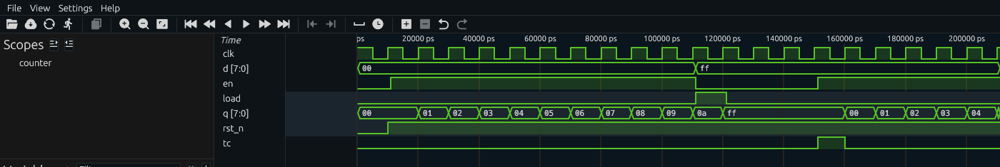
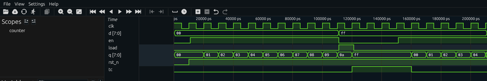

# Waveforms when the assertion is not enough

**Question this page answers:** *The test says `q is 0x32, expected 0x31`. I have read the RTL
four times and it looks right. Now what?*

Now you look at the wires.

An assertion tells you that something was wrong at one instant. A waveform tells you what
everything was doing for the whole run. You reach for it when the assertion has stopped
narrowing things down — usually because the wrong value arrived from somewhere you were not
watching, or arrived at the wrong *time* rather than with the wrong *value*.

It is deliberately the fourth page of five. Most bugs in this course are cheaper to find with a
better assertion message than with a viewer, and reaching for the waveform first is a habit that
costs hours. But some bugs are only visible as a picture, and those are the ones this page is
for.

## Getting a waveform out

```bash
cd labs/cocotb-intro
make waves
```

```
    11.00ns INFO  cocotb.counter  reset released at t = 11 ns
   111.00ns INFO  cocotb.counter  counted to 0x0A at t = 111 ns
   121.00ns INFO  cocotb.counter  loaded 0xFF at t = 121 ns  <-- zoom here
   151.00ns INFO  cocotb.counter  held 3 clocks with en low, still 0xFF, t = 151 ns
   152.00ns INFO  cocotb.counter  en high again at t = 152 ns; the wrap is the next edge
   161.00ns INFO  cocotb.counter  wrapped to 0x00 at t = 161 ns
   211.00ns INFO  cocotb.counter  finished at t = 211 ns with q = 0x05
...
FST info: dumpfile /work/labs/cocotb-intro/build/waves/counter.fst opened for output.

   wrote  /work/labs/cocotb-intro/counter.fst   (699 bytes)
   wrote  /work/labs/cocotb-intro/counter.vcd   (1098 bytes)
```

> **`FST info: dumpfile ... opened for output.` appears *after* the results table.** That is
> Icarus closing the file at the end of the run, not an error and not out of order. The test had
> already passed.

The mechanism is a single make variable:

```bash
make -f sim.mk sim TB=test_04_waves WAVES=1
```

> When you drive `sim.mk` by hand and change `RTL=`, change `SIM_BUILD=` with it. cocotb's
> makefile relinks only when the sources are *newer* than `sim_build/sim.vvp`, so a second run
> against a different design silently re-runs the first one — green, and testing nothing you
> meant to test. Every lab target passes its own `SIM_BUILD` for that reason.

`WAVES=1` makes cocotb's Icarus makefile **generate a dump module for you** — you do not write
`$dumpfile`/`$dumpvars` anywhere:

```
/foss/tools/bin/iverilog ... -s cocotb_iverilog_dump  rtl/counter.sv build/waves/cocotb_iverilog_dump.v
```

It lands as `$(SIM_BUILD)/$(COCOTB_TOPLEVEL).fst` — here, `build/waves/counter.fst`. The lab's
`make waves` copies it up to `counter.fst` and also converts it with `fst2vcd`, so you have both
formats to play with.

> **The dead end.** Searching for "cocotb waveform" will find `COCOTB_PLUSARGS=+WAVES` and
> hand-written `$dumpvars` testbench shells. Both are real techniques — SimProc's `tb.v` uses
> exactly that, because it has a Verilog shell to put it in — but for a design cocotb attaches
> to directly, `WAVES=1` is one word and generates the shell for you. Reach for the manual
> version only when you need to dump a *subset* of a large design.

## FST or VCD?

Same information, two encodings. Use **FST** unless something refuses it.

| | this counter | SimProc, `labs/common` → `make waves` |
|---|---|---|
| signals in the file | 7 | 190 (across 11 scopes) |
| VCD | 1,098 bytes | **3,007,592 bytes** |
| FST | 699 bytes | **12,152 bytes** |

The same processor run is **247 times smaller** as FST. VCD is a text format that writes out
every value change as ASCII; FST is compressed and indexed, so viewers can also seek in it
without reading the whole file. Convert either way with `fst2vcd` / `vcd2fst`, both on the
workbench `PATH`.

VCD is worth knowing because everything reads it, and because you can look at it with `less`
when you suspect the viewer rather than the data.

## Surfer

```bash
surfer counter.fst
```

Surfer 0.6.0 is on the workbench. Open the noVNC desktop, open a terminal there, run that.



That is the whole 211 ns run: reset releases, the counter walks `00`…`0a`, `load` pulses and
`d` puts `ff` in, `en` drops for three clocks while `q` sits at `ff`, then `en` comes back —
`tc` goes high for exactly that one clock — and the count wraps to `00`.

The workflow is three steps:

1. **Scopes** pane, top left: click the module (`counter`). For SimProc you will be walking
   down `tb` → `tt_um_ieeeuoftasic_simproc` → `U1` → `CPU1`.
2. **Variables** pane, bottom left: click signals to add them. Or type `module_add counter` in
   the command box to add every signal in a scope at once.
3. Drag on the time ruler to zoom; `Ctrl` + scroll also zooms.

> **The time axis is in picoseconds.** Surfer's ruler in that screenshot reads `20000 ps`,
> `40000 ps`, … because cocotb's default simulation precision is 1 ps. `20000 ps` is 20 ns.
> The numbers your test logged are in nanoseconds; multiply by 1000 before you go looking.

Surfer can also take a command file, which is how the screenshot above was made and how you
stop re-adding the same signals every time:

```bash
printf 'module_add counter\n' > view.sf
surfer -c view.sf counter.fst
```

## GTKWave

```bash
gtkwave counter.fst
```

GTKWave is the older tool and it is on the workbench too (`v4.0.0-prealpha`). It reads both
formats — `FSTLOAD | Processing 7 facs. / Built 7 signals and 0 aliases.` for FST, and
`[0] start time. / [211000] end time.` for VCD.

**Name the trap before it happens.** GTKWave opens *fully zoomed in*, at time zero:


That is a correctly loaded 211-nanosecond waveform — the header even says `To: 211 ns`. The seven signals are there, on the left.
The pane looks dead because you are looking at the **first four picoseconds** of it, during
which — correctly — nothing happens. The first clock edge after `t = 0` is at 10 ns, which is
2,500 screens to the right.

The fix is **Zoom Fit**: `View → Zoom → Zoom Best Fit`, or `Ctrl` `Alt` `F`, or the toolbar
magnifier with the square in it. Do that first, every single time, before concluding anything.

If GTKWave opens with an empty signal list instead, that is the other half of the same trap:
signals live in the **SST** tree at the top left and you have to `Append` them to the wave pane.
A `.gtkw` save file does it once and remembers:

```bash
gtkwave counter.fst counter.gtkw
```

[`counter.gtkw`](https://github.com/uoftasic/dd104/blob/main/labs/cocotb-intro/counter.gtkw)
ships with the lab and is worth reading — it is a plain text list of signal names.

**Which to use:** Surfer if you have no reason to prefer otherwise — it opens with a sane zoom,
its keyboard handling is better, and it does not need a save file to be useful. GTKWave when
you want its analogue rendering, its transaction filters, or when you are following someone
else's `.gtkw`.

## What to look at first

A whole processor is a lot of signals — SimProc's dump has **190**. Adding all of them is how
you end up scrolling instead of debugging. Start with four kinds of signal, in this order:

**1. The clock and the reset.** Not because they are interesting, but because they are the
first thing that is wrong when everything is wrong. A clock that never toggles means you forgot
`cocotb.start_soon`. A reset that never releases means you drove `rst_n` and never raised it.
Both produce a screen of flat lines and both are five-second fixes.

**2. Anything `X` or red.** Red in Surfer, red in GTKWave: an undriven or conflicting signal. An
`X` propagates — one undriven input turns a whole datapath red three cycles later — so trace it
**backwards to the first signal that is red** and fix that one. Everything downstream of it is a
symptom.

**3. The state register.** In a design with a control FSM, this is the highest-information
signal there is. For SimProc it is `CPU1.curr_state`, and it decodes to `IDLE`,
`CYCLE_1`…`CYCLE_5`. Watching it walk `CYCLE_1 → CYCLE_2 → CYCLE_3 → CYCLE_1` tells you a
three-cycle instruction retired, before you have looked at a single data value.

**4. Whatever your assertion named, at the time it named.** This is why `test_04_waves.py` logs
`loaded 0xFF at t = 121 ns  <-- zoom here`. Knowing the timestamp before you open the viewer is
the difference between reading a waveform and scrolling through one.

**Reflex check:** before adding a fifth signal, ask what you expect it to show. If you cannot
say, you are browsing, not debugging — go back to the assertion and make it print more.

## Try this: see a bug as a picture

Point the wave run at the broken counter:

```bash
make -f sim.mk sim TB=test_04_waves WAVES=1 RTL=rtl/counter_broken.sv \
     SIM_BUILD=build/bw COCOTB_RESULTS_FILE=build/bw.xml
surfer build/bw/counter.fst
```

**What you should see:** it passes, and its log is **identical, line for line**, to the good
run's — same times, same values, same `PASS`. `test_04_waves` never checks `tc`, so nothing in
the text output distinguishes the two counters at all.

Now look at the picture:



Compare the bottom trace with the one above. On the good counter `tc` is a single narrow pulse
— one clock wide, at t = 152–161 ns, the one clock where `q` is `0xFF` **and** `en` is high. On
the broken one `tc` goes high at t = 121 ns, the instant `q` becomes `0xFF`, and stays high for
the whole four-clock stretch, including three clocks where the counter is not moving at all.

Everything else on the screen is pixel-identical.

**Why an engineer cares:** the difference between those two runs is one trace being four times
too wide, and it is completely invisible in the log — every logged value is the same. Some bugs
are shaped like a waveform. Knowing which ones is the skill, and it is why the viewer is a tool
you learn *before* you need it rather than during the hour you need it.

Next: [Two simulators, two jobs](guide/two-simulators-two-jobs.md) — and then Lab 1, where the design
is a processor, the bugs were planted by someone else, and nobody tells you which of the
thirteen you are looking for.
